# TP5 — Agentic AI et MCP

Réalisation progressive d’agents intelligents avec **LangChain, LangGraph, Groq et Model Context Protocol (MCP)**, jusqu’à un système multi-agents de service après-vente (SAV).

## Sommaire

- [Installation](#installation)
- [Architecture du projet](#architecture-du-projet)
- [Partie A — LangChain](#partie-a--langchain)
- [Partie B — LangGraph](#partie-b--langgraph)
- [Partie C — MCP](#partie-c--mcp)
- [Partie D — Système multi-agents SAV](#partie-d--système-multi-agents-sav)
- [Bilan et limites](#bilan-et-limites)

## Installation

### Prérequis

- Python et environnement virtuel `.venv` (une version compatible avec les dépendances installées).
- Node.js et npm pour MCP Inspector et n8n.
- Une clé API Groq et une connexion Internet pour le LLM et le téléchargement initial des embeddings.

Depuis la racine du projet, dans PowerShell :

```powershell
python -m venv .venv # uniquement si absent
.\.venv\Scripts\Activate.ps1
python -m pip install -r requirements.txt
```

Si `requirements.txt` n’est pas encore disponible, installer les principales dépendances :

```powershell
python -m pip install langchain langgraph langchain-groq langchain-community langchain-experimental langchain-text-splitters langchain-chroma langchain-huggingface sentence-transformers pypdf pymupdf pillow python-dotenv ddgs langchain-tavily langchain-mcp-adapters "mcp[cli]" streamlit "langgraph-cli[inmem]"
```

### Configuration

Créer ou compléter `.env` à la racine :

```dotenv
GROQ_API_KEY=votre_cle_groq
GROQ_MODEL=openai/gpt-oss-120b
EMBEDDING_MODEL=sentence-transformers/paraphrase-multilingual-MiniLM-L12-v2
MCP_SERVER_URL=http://127.0.0.1:8000/mcp
MCP_SAV_URL=http://127.0.0.1:8001/mcp
# Optionnel : Tavily et tracing LangSmith
# TAVILY_API_KEY=votre_cle_tavily
# LANGSMITH_API_KEY=votre_cle_langsmith
# LANGSMITH_TRACING=true
# LANGSMITH_PROJECT=TP5-Agentic-RAG
```

Ne jamais publier les clés API. Ajouter `.env`, `.venv/`, `__pycache__/` et les bases vectorielles générées au `.gitignore`.

## Architecture du projet

```text
TP5/
├── .env
├── requirements.txt
├── langgraph.json
├── partie_A_LangChain/
│   ├── 01_agent_simple/
│   ├── 02_agent_memoire/
│   ├── 03_custom_tools/
│   ├── 04_predefined_tools/
│   ├── 05_middlewares/
│   └── 06_agentic_rag/
├── partie_B_LangGraph/
│   ├── 01_bases_langgraph/
│   ├── 02_agentic_rag/
│   └── 03_streamlit/
├── partie_C_MCP/
│   ├── 01_serveur_mcp/
│   ├── 02_agents_mcp/
│   └── 03_n8n/
└── partie_D_Synthese/
    ├── documents/
    ├── images/
    ├── data/
    ├── chroma_db/
    ├── config.py
    ├── create_documents.py
    ├── ingestion.py
    ├── mcp_server.py
    ├── local_tools.py
    ├── state.py
    ├── nodes.py
    ├── graph.py
    ├── main.py
    └── test_system.py
```

Les chemins des premiers exercices A sont indicatifs ; vérifier les noms locaux avec `Get-ChildItem partie_A_LangChain -Recurse -Filter *.py`. Toutes les commandes suivantes partent de la racine, sauf indication contraire.

## Partie A — LangChain

### A.1 — Agent simple et mémoire

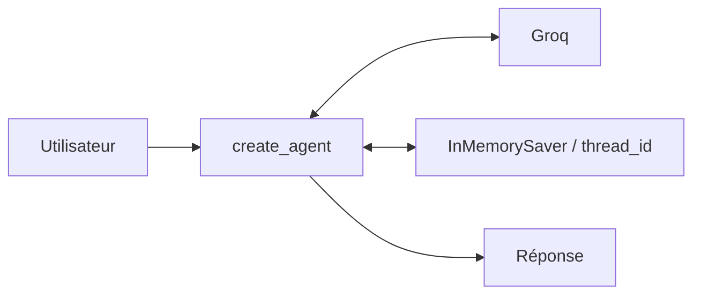

`create_agent` automatise la boucle agent/outils. `InMemorySaver` conserve le contexte en RAM par `thread_id`.

```powershell
python partie_A_LangChain/01_agent_simple/agent_simple.py
python partie_A_LangChain/02_agent_memoire/agent_memoire.py
```

Test : « Je m’appelle Amine », puis « Quel est mon prénom ? ». Attendu : Amine dans le même thread.

### A.2 — Outils personnalisés et prédéfinis

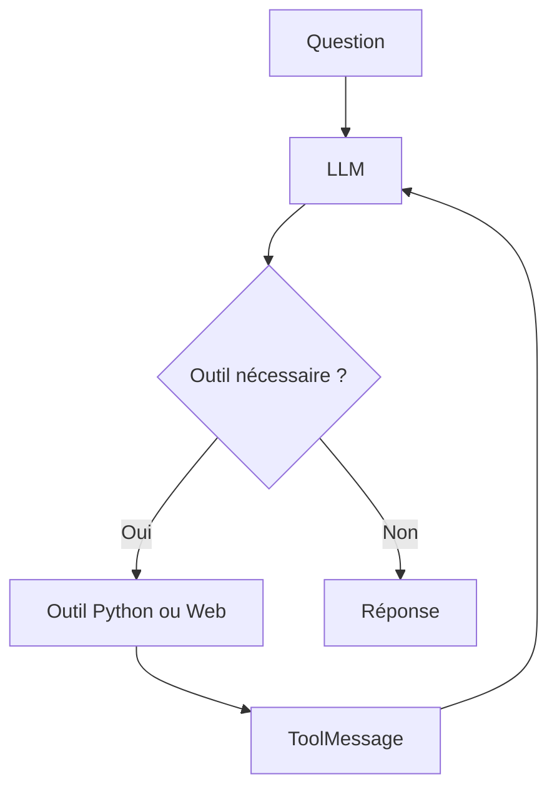

```powershell
python partie_A_LangChain/03_custom_tools/agent_tools.py
python partie_A_LangChain/04_predefined_tools/agent_predefinis.py
```

| Test | Attendu |
|---|---|
| 25 + 35 | additionner : 60 |
| 7 × 8 | multiplier : 56 |
| Recherche Web | DuckDuckGo ou Tavily |
| Somme de 1 à 10 avec Python | PythonREPLTool : 55 |

Les recherches Web dépendent du réseau et des clés. Le REPL doit être réservé à un environnement isolé et à des entrées de confiance.

### A.3 — Middlewares

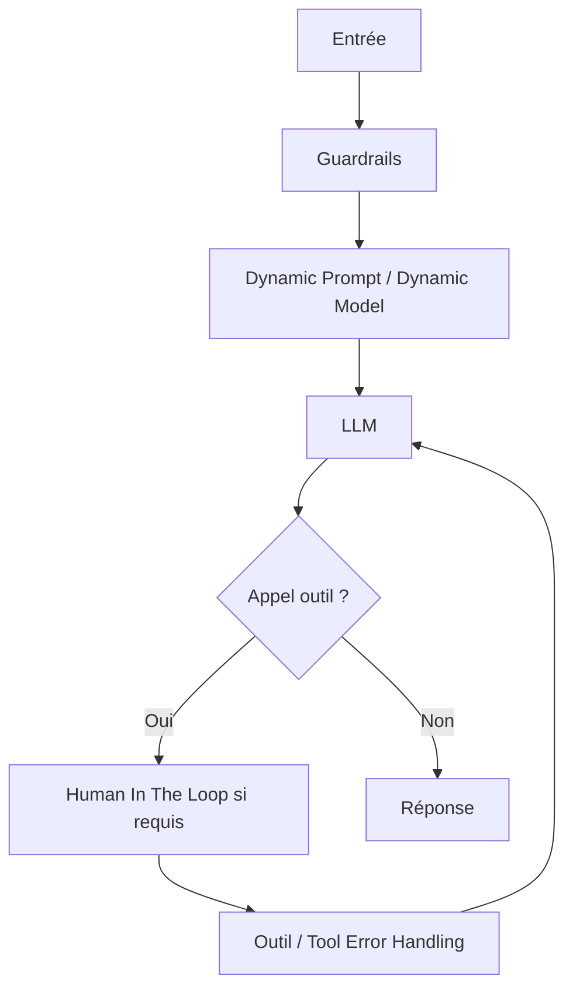

Schéma conceptuel des points d’intervention, dont l’ordre dépend de la configuration.

```powershell
python partie_A_LangChain/05_middlewares/agent_middlewares.py
# Ou exécuter séparément les scripts middleware_*.py existants.
```

| Middleware | Test attendu |
|---|---|
| Dynamic Model | Sélection du modèle selon la règle |
| Dynamic Prompt | Adaptation des instructions |
| Tool Error Handling | Erreur d’outil contrôlée |
| Guardrails | Blocage d’une entrée interdite fictive |
| Human In The Loop | Suspension puis reprise après approbation |

### A.4 — Agentic RAG

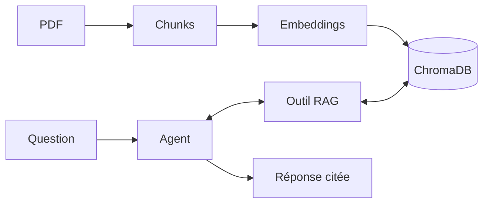

Document : *Attention Is All You Need*, à placer dans `partie_A_LangChain/06_agentic_rag/documents/`.

```powershell
python partie_A_LangChain/06_agentic_rag/ingestion.py
python partie_A_LangChain/06_agentic_rag/test_rag.py
python partie_A_LangChain/06_agentic_rag/agent_rag.py
```

Tests : Transformer original → 8 têtes d’attention, 6 couches d’encodeur ; salutation → réponse directe. L’agent décide quand utiliser le RAG.

## Partie B — LangGraph

### B.1 — Bases

`State` : données partagées ; `Node` : fonction ; `Edge` : transition ; `Conditional Edge` : choix du chemin ; `compile()` : construction du graphe exécutable.

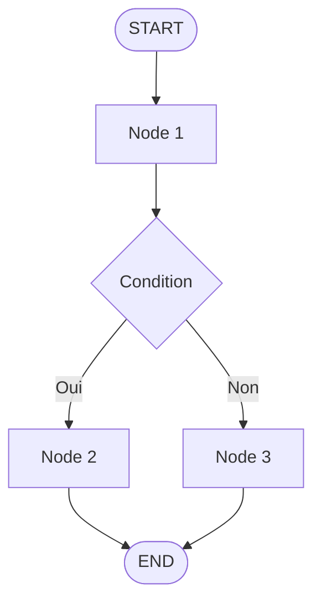

```powershell
Get-ChildItem partie_B_LangGraph/01_bases_langgraph -Filter *.py
# Exécuter le script correspondant avec python.
```

### B.2 — Agentic RAG

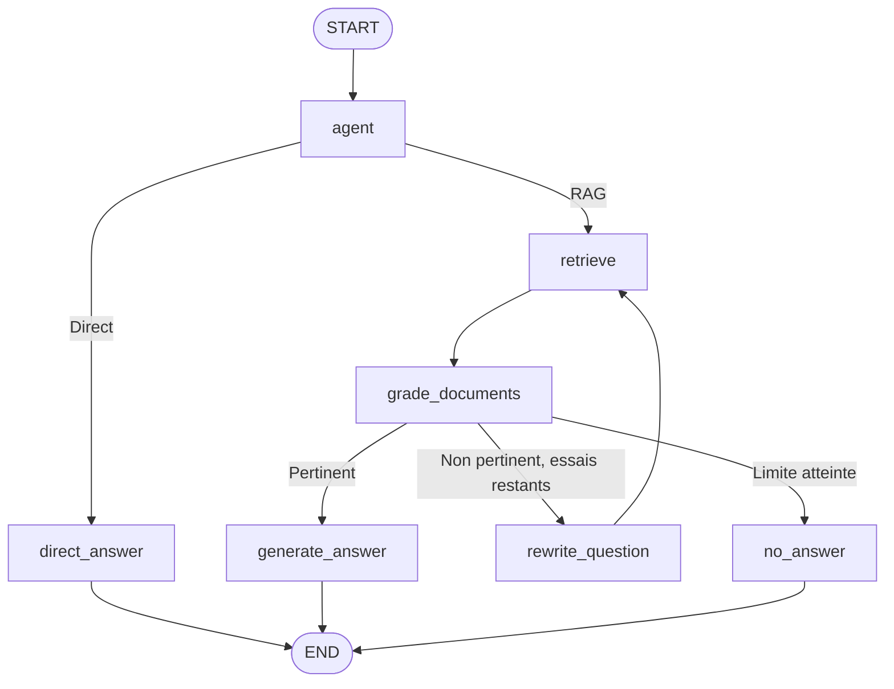

Réutilise l’index ChromaDB de A. Deux reformulations supplémentaires maximum.

```powershell
python partie_B_LangGraph/02_agentic_rag/test_rag.py
python partie_B_LangGraph/02_agentic_rag/main.py
```

Attendu : question documentaire → recherche, évaluation et réponse citée ; salutation → réponse directe.

### B.3 — LangGraph Studio

```powershell
langgraph dev
```

Sélectionner `agentic_rag` et fournir une entrée `messages` :

```json
{"messages":[{"role":"human","content":"Combien de couches contient l’encodeur du Transformer ?"}]}
```

Attendu : visualisation du graphe, des états et de la réponse (6 couches).

### B.4 — Streamlit

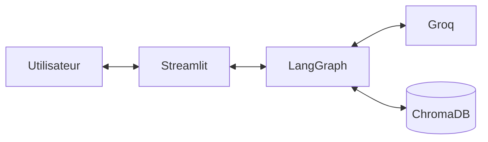

```powershell
python -m streamlit run partie_B_LangGraph/03_streamlit/app.py
```

Ouvrir <http://localhost:8501>. Attendu : chat, historique et sources.

## Partie C — MCP

### C.1 — Serveur et Inspector

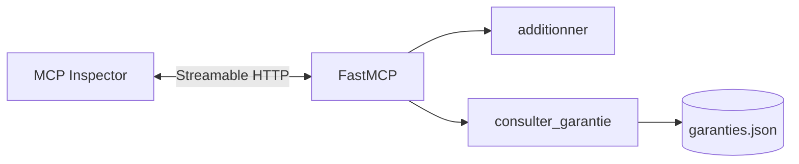

Terminal 1 :

```powershell
python partie_C_MCP/01_serveur_mcp/server.py
```

Terminal 2 :

```powershell
npx.cmd -y @modelcontextprotocol/inspector
```

Configurer Streamable HTTP, URL `http://127.0.0.1:8000/mcp`, puis lister et appeler les outils.

```powershell
python partie_C_MCP/01_serveur_mcp/test_client.py
```

| Outil | Entrée | Attendu |
|---|---|---|
| additionner | a=25, b=35 | 60 |
| consulter_garantie | PX200-0042 | Active jusqu’au 15/06/2028 |
| consulter_garantie | TV500-0125 | Expirée |
| consulter_garantie | XYZ-9999 | Introuvable |

### C.2 — Clients LangChain et LangGraph

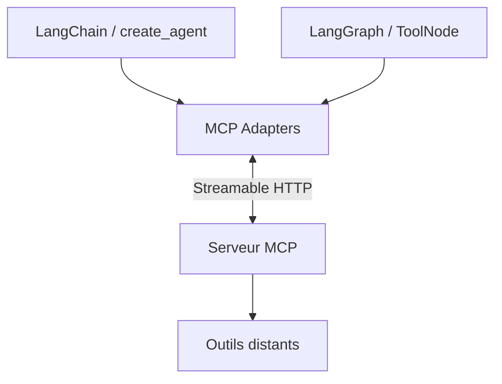

Les deux utilisent `MultiServerMCPClient` et `get_tools()`. LangChain orchestre automatiquement les outils ; LangGraph utilise explicitement `ToolNode` et `tools_condition` dans cet exercice.

Garder le serveur C.1 actif :

```powershell
python partie_C_MCP/02_agents_mcp/test_mcp_tools.py
python partie_C_MCP/02_agents_mcp/agent_langchain.py
python partie_C_MCP/02_agents_mcp/agent_langgraph.py
python partie_C_MCP/02_agents_mcp/test_agents.py
```

Tests : addition, garantie active, expirée, inconnue et salutation. Score initial observé : **8/10**. Objectif après correction du prompt : 10/10 (non confirmé).

### C.3 — n8n

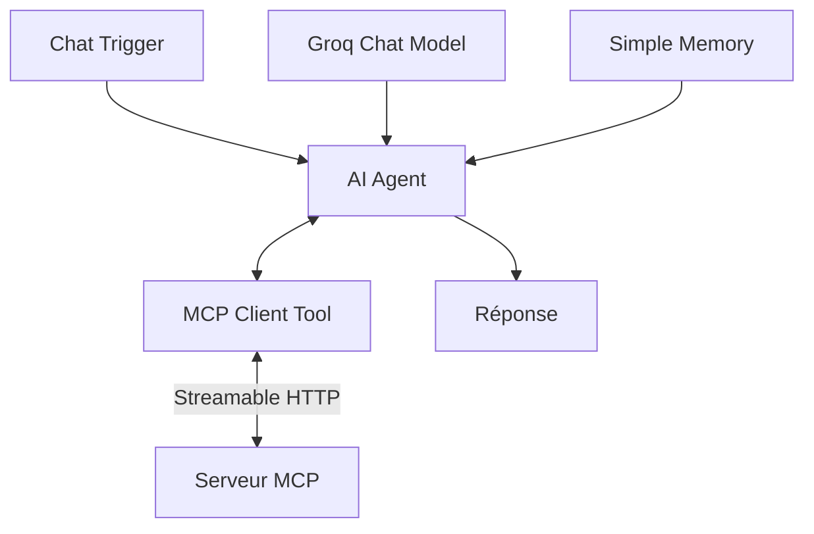

```powershell
npm.cmd install -g n8n # première installation
n8n.cmd start
```

Ouvrir <http://localhost:5678>. Connecter les cinq nœuds ; sélectionner Groq, modèle `openai/gpt-oss-120b`, et configurer MCP Client Tool sur `http://127.0.0.1:8000/mcp`, transport Streamable HTTP, sans authentification pour cette démonstration locale.

Tester dans Open Chat les mêmes scénarios que C.2 et exporter le workflow vers `partie_C_MCP/03_n8n/workflow_mcp.json`.

## Partie D — Système multi-agents SAV

### Architecture globale

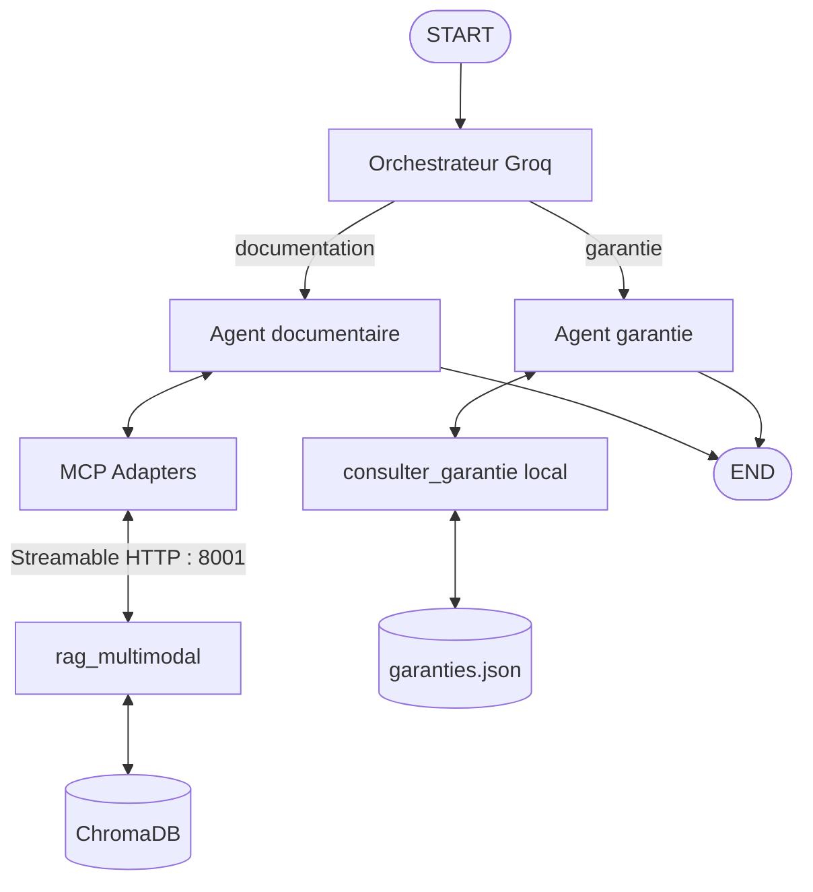

L’orchestrateur choisit exactement une catégorie. Les outils sont appelés explicitement dans les nœuds spécialisés, sans `ToolNode`. Une demande mixte privilégie la garantie dans cette implémentation.

### D.1 — Préparation et ingestion

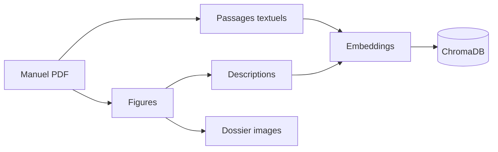

```powershell
Copy-Item partie_C_MCP/01_serveur_mcp/data/garanties.json partie_D_Synthese/data/garanties.json
python partie_D_Synthese/create_documents.py
python partie_D_Synthese/ingestion.py
```

Attendu : manuel fictif `manuel_PX200.pdf`, figure `img_px200_01.png`, 4 entrées indexées (3 textes et 1 description de figure). Le nombre varie avec les documents.

### D.2 — Serveur documentaire

Terminal 1 :

```powershell
python partie_D_Synthese/mcp_server.py
```

Terminal 2 :

```powershell
npx.cmd -y @modelcontextprotocol/inspector
```

URL : `http://127.0.0.1:8001/mcp`. Appeler `rag_multimodal` :

```json
{"question":"Que signifie le voyant STATUS orange clignotant du PX-200 ?"}
```

Attendu : phase d’initialisation, manuel page 2, référence `img_px200_01`. Les figures sont recherchées par leurs descriptions textuelles, sans analyse directe des pixels.

### D.3 — Garantie locale

```powershell
python partie_D_Synthese/local_tools.py
```

Attendu : PX200-0042, garantie active jusqu’au 15/06/2028. L’outil lit le JSON sans le modifier et calcule le statut selon la date du jour.

### D.4 — Système complet

Garder le serveur documentaire actif :

```powershell
python partie_D_Synthese/main.py
python partie_D_Synthese/test_system.py
```

| Question | Agent | Attendu |
|---|---|---|
| Voyant STATUS orange clignotant | Documentation | Page 2 et figure |
| Nettoyage PX-200 | Documentation | Page 3 |
| Garantie PX200-0042 | Garantie | Active |
| Garantie TV500-0125 | Garantie | Expirée |
| Garantie XYZ-9999 | Garantie | Introuvable |
| Mon produit est-il sous garantie ? | Garantie | Demander le numéro de série |

Objectif : `SCORE GLOBAL : 6/6` (non confirmé). Vérifier aussi les réponses et citations manuellement. Arrêter le serveur MCP : la garantie doit rester disponible, contrairement au service documentaire.

### D.5 — Visualisation dans Studio (optionnelle)

Ajouter le graphe `sav` au fichier `langgraph.json` existant :

```json
{
  "dependencies": ["."],
  "graphs": {
    "agentic_rag": "./partie_B_LangGraph/02_agentic_rag/graph.py:studio_graph",
    "sav": "./partie_D_Synthese/graph.py:app"
  },
  "env": "./.env"
}
```

```powershell
langgraph dev
```

Sélectionner `sav` et renseigner `question`. Les imports locaux doivent être résolus correctement dans Studio.

## Bilan et limites

| Technologie | Responsabilité |
|---|---|
| LangChain | Agents, outils, mémoire, middlewares |
| LangGraph | État, nœuds et orchestration conditionnelle |
| MCP | Protocole standardisé d’accès aux outils distants |
| MCP Adapters | Découverte et adaptation des outils MCP |
| ToolNode | Exécution des appels d’outils dans un graphe |
| ChromaDB | Recherche vectorielle |
| Groq | Classification et génération des réponses |

Les données SAV sont fictives. Les serveurs MCP sont destinés à une démonstration locale, sans exposition publique. Les tests de D et n8n restent à confirmer ; le score initial C.2 est de 8/10. Les commandes des premiers exercices A peuvent nécessiter une adaptation aux noms de fichiers réels.

---

Projet pédagogique — TP5 : Agentic AI et MCP.
